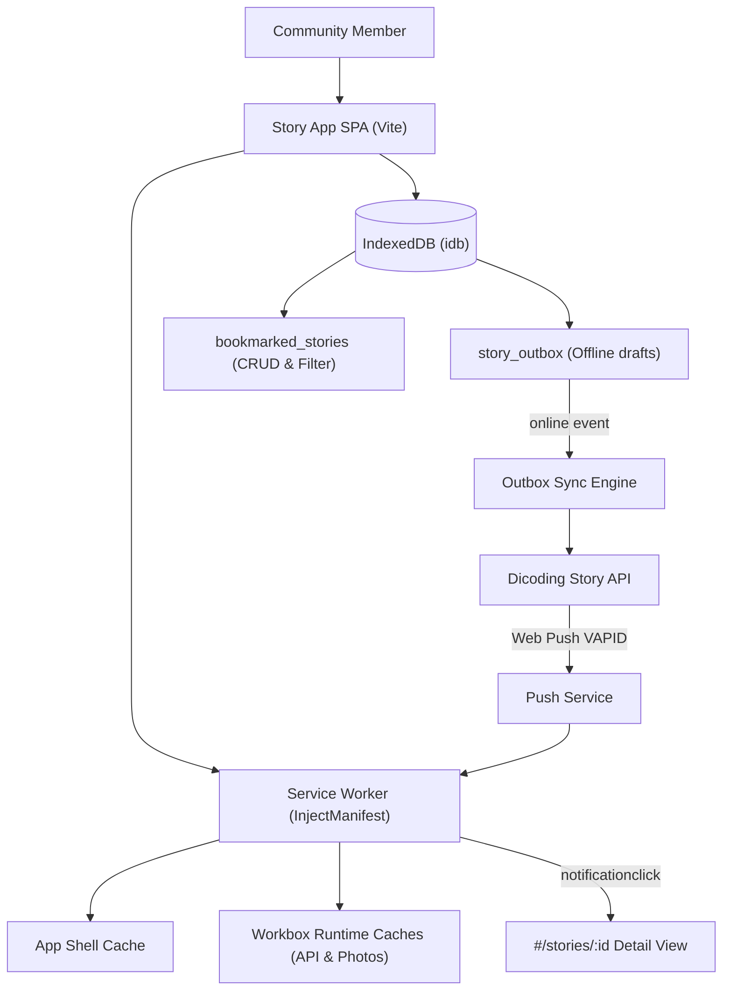

# Spec: Progressive Web App, Push Notifications, and Offline Synchronization (Dicoding Story App Project 2)

**Status:** `ready-for-agent`  
**Feature Slug:** `dicoding-story-app-pwa`  
**Governing ADRs:**
- [`docs/adr/0001-strict-passive-view-mvp.md`](file:///c:/Users/alifk/Codex/Dicoding/Belajar%20Pengembangan%20Web%20Intermediate/docs/adr/0001-strict-passive-view-mvp.md)
- [`docs/adr/0002-keyless-multi-tile-leaflet-map.md`](file:///c:/Users/alifk/Codex/Dicoding/Belajar%20Pengembangan%20Web%20Intermediate/docs/adr/0002-keyless-multi-tile-leaflet-map.md)
- [`docs/adr/0003-router-lifecycle-and-skip-link-interception.md`](file:///c:/Users/alifk/Codex/Dicoding/Belajar%20Pengembangan%20Web%20Intermediate/docs/adr/0003-router-lifecycle-and-skip-link-interception.md)
- [`docs/adr/0004-service-worker-inject-manifest-and-push.md`](file:///c:/Users/alifk/Codex/Dicoding/Belajar%20Pengembangan%20Web%20Intermediate/docs/adr/0004-service-worker-inject-manifest-and-push.md)
- [`docs/adr/0005-dual-indexeddb-stores-for-bookmarks-and-outbox.md`](file:///c:/Users/alifk/Codex/Dicoding/Belajar%20Pengembangan%20Web%20Intermediate/docs/adr/0005-dual-indexeddb-stores-for-bookmarks-and-outbox.md)
- [`docs/adr/0006-runtime-caching-topology.md`](file:///c:/Users/alifk/Codex/Dicoding/Belajar%20Pengembangan%20Web%20Intermediate/docs/adr/0006-runtime-caching-topology.md)

---

## Problem Statement

Members of the Dicoding Story community frequently encounter connectivity drops in transit and loss of Internet access when traveling to remote locations to capture stories. In the current Single Page Application:
1. When connectivity is unavailable, members cannot view previously loaded Stories, cannot inspect story locations on digital maps, and cannot access the Story Feed.
2. If an Author composes a Draft Story while offline, attempting to publish immediately fails, risking the loss of composed narrative and captured photos.
3. Members have no local mechanism to curate and bookmark favorite community Stories for offline reading.
4. Members receive no updates when new Stories are published by peers unless they actively refresh the browser.
5. The application is accessed solely via browser URL without home-screen installability or standalone app-like experience.

---

## Solution

Transform the existing 5-star Story App into a full Progressive Web App (PWA) satisfying all Dicoding Advance criteria:
1. **Web App Manifest & Installability:** Provide a standard Web App Manifest with icons (including maskable), shortcuts, wide and narrow screenshots, theme colors, and standalone display.
2. **Application Shell & Runtime Caching:** Use Workbox with an InjectManifest Service Worker to precache core assets and apply tiered runtime caching (`NetworkFirst` for Story API payloads, `StaleWhileRevalidate` for Story photos, `CacheFirst` for CDN fonts/styles).
3. **Local Bookmarking (IndexedDB CRUD):** Allow members to bookmark Stories into a local `bookmarked_stories` object store, view them on a dedicated `#/favorites` view, filter/sort by query or location, and remove bookmarks.
4. **Offline Story Outbox & Automatic Sync:** If a Draft Story is submitted while offline, persist it in a local `story_outbox` object store with user feedback, and automatically synchronize/upload when the device regains connectivity (`online` event).
5. **Web Push Notification:** Enable opt-in background Push Notifications using the Dicoding Story API VAPID key with UI subscription toggle, custom notification payload formatting, and `notificationclick` navigation to Story Detail.
6. **Public Deployment:** Build production bundle and host on Netlify with SPA redirect configuration, generating the required `STUDENT.txt`.

---

## Architecture Flowchart

---

## User Stories

1. As an Author, I want to install the Story App on my desktop or mobile home screen, so that I can launch it like a native application.
2. As an Author, I want the web app manifest to display shortcuts for "Tambah Cerita" and "Cerita Tersimpan", so that I can jump directly to primary tasks from the app icon.
3. As an Author, I want the application shell to load instantly even when I have no Internet connection, so that I never see a browser dinosaur error.
4. As an Author, I want to view previously loaded Stories in the Story Feed while offline, so that I can browse community content without network access.
5. As an Author, I want to view previously loaded Story details and photos while offline, so that I can read stories uninterrupted in airplane mode.
6. As an Author, I want to bookmark any Story from its card or detail view, so that I can curate my personal reading collection.
7. As an Author, I want to navigate to a dedicated "Cerita Tersimpan" (`#/favorites`) page, so that I can see all my Bookmarked Stories in one place.
8. As an Author, I want to search and filter my Bookmarked Stories by keyword and location status, so that I can quickly find specific saved stories offline.
9. As an Author, I want to remove a Story from my bookmarks at any time, so that my collection remains relevant.
10. As an Author, I want to compose and submit a Draft Story while my device is offline, so that I do not lose my photos or story descriptions.
11. As an Author, I want clear visual feedback when an offline Draft Story is saved to the Story Outbox, so that I know my content is safe.
12. As an Author, I want the Story Outbox to automatically upload pending Draft Stories as soon as my internet connection recovers, so that I don't have to manually re-enter data.
13. As an Author, I want a toggle button in the navigation bar to subscribe or unsubscribe to Web Push Notifications, so that I have complete control over receiving alerts.
14. As an Author, I want incoming push notifications to display the Story title, excerpt, and author name dynamically, so that I know what new content has arrived.
15. As an Author, I want clicking a push notification to open the browser directly to the corresponding Story Detail view, so that I can read the new story immediately.
16. As an Author, I want my active session, authentication token, and logout capabilities to remain completely intact across all PWA modes, so that security is never compromised.
17. As an Author, I want all keyboard navigation, skip-to-content links, and mobile drawer accessibility fixes to remain fully compliant with WCAG standards, so that the app remains accessible to all.
18. As a Reviewer, I want to visit the publicly deployed application URL on Netlify recorded in `STUDENT.txt`, so that I can evaluate the production application.

---

## Implementation Decisions

1. **Service Worker Build Pipeline (ADR-0004):**
   - Use `vite-plugin-pwa` with `strategies: 'injectManifest'` and `srcDir: 'src'`, `filename: 'sw.js'`.
   - In `src/sw.js`, call `precacheAndRoute(self.__WB_MANIFEST)` to cache static build outputs.
   - Attach dedicated `push` and `notificationclick` listeners inside `src/sw.js` for custom notification handling and URL routing.

2. **Workbox Runtime Caching Strategy (ADR-0006):**
   - `NetworkFirst` strategy for `https://story-api.dicoding.dev/v1/stories*` with a 24-hour cache expiration.
   - `StaleWhileRevalidate` strategy for `https://story-api.dicoding.dev/images/stories/*` with cache size capped at 60 entries.
   - `CacheFirst` strategy for Leaflet tile servers, stylesheets, and Google Fonts.

3. **Database Architecture with `idb` (ADR-0005):**
   - Initialize database `dicoding-story-db` at version 1 with two object stores:
     - `bookmarked_stories` with keyPath `id` and index `createdAt`.
     - `story_outbox` with autoIncrement keyPath `outboxId` and index `createdAt`.
   - Provide clean Model interface methods: `saveBookmark(story)`, `getBookmark(id)`, `getAllBookmarks()`, `deleteBookmark(id)`, `isBookmarked(id)`.
   - Provide outbox methods: `queueDraftStory(draftData)`, `getPendingStories()`, `removePendingStory(outboxId)`.

4. **Offline Synchronization Mechanism:**
   - Listen to `window.addEventListener('online', ...)` and call `OutboxSyncManager.syncPendingStories()`.
   - When submitting a story in `AddStoryPresenter`, if `navigator.onLine === false`, divert payload into `story_outbox`, show success feedback indicating offline queue status, and redirect to `#/`.

5. **Web Push Notification Integration:**
   - Implement `PushNotificationHelper` to manage permission requests, VAPID key conversion (`urlBase64ToUint8Array`), subscription creation via `registration.pushManager.subscribe()`, and synchronization with Dicoding Story API subscribe/unsubscribe endpoints.
   - Provide a toggle component in the navigation bar showing current subscription status.

6. **Web App Manifest Specification:**
   - Configure manifest with:
     - `name`: "Story App — Berbagi Cerita"
     - `short_name`: "Story App"
     - `start_url`: "#/"
     - `display`: "standalone"
     - `background_color`: "#f8f9fa"
     - `theme_color`: "#2563eb"
     - Icons: 192x192, 512x512, and maskable icons.
     - `shortcuts`: Links to `#/add` and `#/favorites`.
     - `screenshots`: 1 wide screenshot (desktop) and 1 narrow screenshot (mobile).

7. **Deployment:**
   - Deploy to Netlify using build command `npm run build` and publish directory `dist`.
   - Add `public/_redirects` with rule `/* /index.html 200`.
   - Write public deployment URL to `STUDENT.txt`.

---

## Testing Decisions

- **Presenter & Boundary Tests (Vitest + JSDOM):**
  - Test `FavoritesPresenter` with fake View and fake Database Model: verify bookmark addition, deletion, list loading, and filtering.
  - Test `OutboxSyncManager`: verify that when online event fires, queued items are fetched from outbox and submitted to `StoryModel.createStory()`.
  - Test `PushNotificationHelper`: verify permission check, subscribe payload creation, and error resilience.
- **Regression Tests:**
  - Preserve all existing 27 unit tests (`story-model.test.js`, `auth-presenter.test.js`, `home-presenter.test.js`, `story-detail-presenter.test.js`, `add-story-presenter.test.js`).
- **End-to-End Browser QA (`/browser`):**
  - Verify offline mode via Chrome DevTools network throttling ("Offline").
  - Verify IndexedDB contents in Application panel.
  - Verify Service Worker activation, precache, and runtime caches.
  - Verify Manifest status (0 warnings).

---

## Out of Scope

- Multi-user local account switching in IndexedDB (single active member per device storage).
- Video and audio story attachments (the API and rubric strictly specify image photos).
- Full background sync API polyfill for browsers lacking ServiceWorker SyncManager support (we rely on standard `online` event listener which works universally).

---

## Further Notes

- The project remains strictly on the Passive View MVP pattern ([ADR-0001](file:///c:/Users/alifk/Codex/Dicoding/Belajar%20Pengembangan%20Web%20Intermediate/docs/adr/0001-strict-passive-view-mvp.md)).
- All accessibility enhancements from Submission 1 review (drawer `visibility: hidden/visible`, explicit labels, skip link) are preserved.
