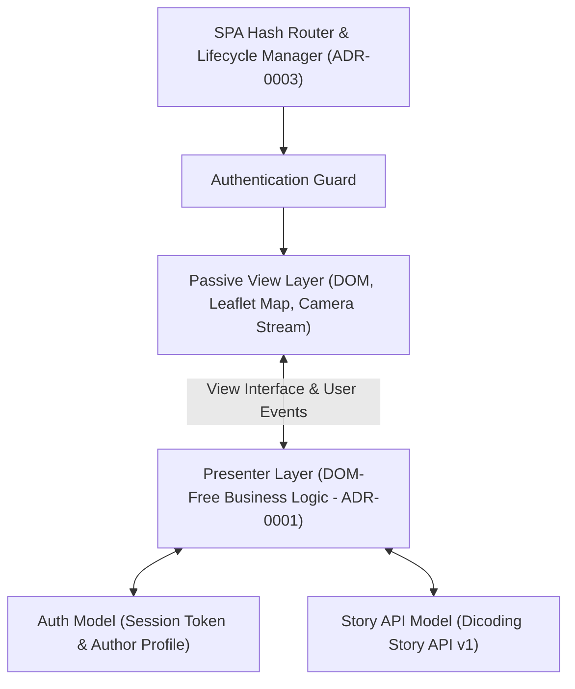
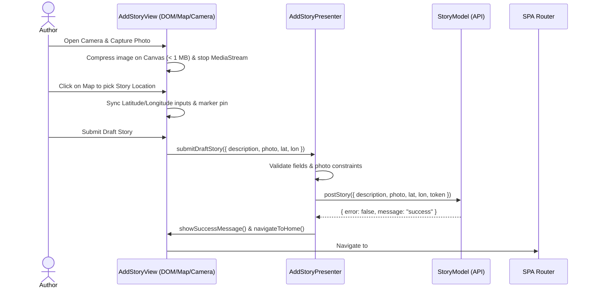

# Dicoding Story App — Submission Pertama Specification

**Status:** ready-for-agent

## Problem Statement

Community members learning and building on Dicoding lack an accessible, responsive, location-aware web platform to share visual **Stories** and explore where fellow **Authors** are posting from. Existing starter templates only provide a static shell without authentication, API integration, interactive geographic visualization, live camera capture, or keyboard-first accessibility. Furthermore, naive Single-Page Application (SPA) implementations often suffer from abrupt page replacements, lingering hardware camera streams after route navigation, and broken "Skip to Content" anchor links that collide with hash routing.

## Solution

Build the **Dicoding Story App** as a hash-routed Single-Page Application (SPA) following a strict Passive View Model-View-Presenter (MVP) architecture (`ADR-0001`). Authenticated community members can browse a synchronized **Story Feed** and multi-layer interactive digital map (`ADR-0002`), filter **Stories** by **Story Location** via a **Location Filter**, inspect individual **Story** details, and publish a new **Draft Story** using either file upload or live camera capture (automatically compressed under 1 MB) with two-way map coordinate selection. Every route change uses custom View Transitions, cleans up active hardware resources (`ADR-0003`), and adheres to WCAG accessibility standards across mobile (`375px`), tablet (`768px`), and desktop (`1024px`) viewports.

## User Stories

1. As a visitor without an account, I want to register a new **Author** account with my name, email address, and a password of at least 8 characters, so that I can join the community and access the platform.
2. As a visitor filling out the registration form, I want to receive immediate validation feedback if my name is empty, my email is invalid, or my password is shorter than 8 characters, so that I can correct mistakes before submitting.
3. As a registered **Author**, I want to log in with my email and password, so that my session token is stored and I am redirected to the **Story Feed**.
4. As an unauthenticated visitor, I want any attempt to visit protected routes (`#/`, `#/stories/:id`, `#/add`) to automatically redirect me to `#/login`, so that private routes are never exposed without a valid session.
5. As an authenticated **Author**, I want attempts to visit `#/login` or `#/register` to automatically redirect me to `#/`, so that I do not see redundant login screens while already signed in.
6. As an authenticated **Author**, I want to log out from the navigation bar, so that my session token is cleared and I am returned to `#/login`.
7. As an **Author** navigating between any two pages (`#/login`, `#/register`, `#/`, `#/stories/:id`, `#/add`), I want the page change to run without a full browser reload using a smooth custom slide-and-fade View Transition while keeping the site header visually anchored, so that navigation feels fluid and contextual.
8. As an **Author** who prefers reduced motion (`prefers-reduced-motion: reduce`), I want page transitions to respect my operating system accessibility setting, so that I do not experience motion discomfort.
9. As an authenticated **Author** on the home page (`#/`), I want to view the **Story Feed** fetched from the Dicoding Story API where each **Story** card displays the **Story** photo, the **Author** name, the **Story** description, the formatted publication date, and its **Story Location** status/coordinates, so that I can read recent community posts at a glance.
10. As an authenticated **Author** on the home page (`#/`), I want to see loading indicators while the **Story Feed** is being fetched and a clear error state with a retry button if the network request fails, so that I always know the system status.
11. As an authenticated **Author** on the home page (`#/`), I want all **Stories** that have a **Story Location** to be plotted as interactive markers on a digital map alongside the **Story Feed**, so that I can explore where each **Story** took place.
12. As an authenticated **Author** interacting with the digital map, I want to click a map marker to open a popup showing the **Story** photo thumbnail, **Author** name, description excerpt, coordinates, and a link to its detail view, so that I can inspect a **Story** directly from the map.
13. As an authenticated **Author** on the home page (`#/`), I want clicking a **Story** card's "Locate on Map" action in the **Story Feed** to set that item as the **Active Story**, smoothly pan/zoom (`flyTo`) the digital map to its marker, open its popup, and visually highlight both the card and marker, so that the list and map stay synchronized.
14. As an authenticated **Author** on the home page (`#/`), I want clicking a marker on the digital map to set that **Story** as the **Active Story** and highlight the corresponding card in the **Story Feed**, so that synchronization works in both directions.
15. As an authenticated **Author** on the home page (`#/`), I want to toggle the **Location Filter** between "All Stories" and "With Location Only", so that I can focus on geo-tagged **Stories** or browse all posts.
16. As an authenticated **Author** using the digital map, I want a layer control allowing me to switch between at least three distinct map tile layers (OpenStreetMap Standard, OpenTopoMap, and Esri World Imagery Satellite) without requiring a personal API key (`ADR-0002`), so that I can inspect **Story Locations** in street, topographic, or satellite views.
17. As an authenticated **Author**, I want to click on a **Story** to open its dedicated detail page (`#/stories/:id`) displaying the full-resolution photo, complete description, **Author** name, formatted creation timestamp, and a dedicated multi-layer map centered on its **Story Location** (if coordinates exist), so that I can read the full context of a single **Story**.
18. As an authenticated **Author** on the Add Story page (`#/add`), I want to compose a **Draft Story** by entering a description and providing a photo via either file upload or live camera capture, so that I can share moments using whichever media source I prefer.
19. As an authenticated **Author** using live camera capture on `#/add`, I want to start my device camera preview (`getUserMedia`), switch between available cameras if my device has more than one, capture a snapshot onto a preview canvas, or retake the snapshot, so that I can take a photo directly within the web app.
20. As an authenticated **Author** using live camera capture on `#/add`, I want the active camera hardware stream (`MediaStreamTrack`) to stop immediately when I capture a photo, click "Close Camera", submit the form, or navigate away to another route (`hashchange`), so that my camera indicator light never remains on unintentionally (`ADR-0003`).
21. As an authenticated **Author** attaching a photo to a **Draft Story** (via file upload or camera capture), I want images larger than 1 MB to be automatically resized and compressed via HTML5 Canvas below the 1 MB API limit (with clear validation errors for unsupported non-image files), so that my upload never fails due to high-resolution phone or webcam photos.
22. As an authenticated **Author** on `#/add`, I want to set the **Story Location** of my **Draft Story** either by clicking directly on the interactive map or by typing latitude and longitude values into labeled input fields (with two-way synchronization between the inputs and the draggable/clickable map marker, plus a "Use My Current Location" geolocation button and a "Clear Location" button), so that both mouse and keyboard users can specify coordinates accurately.
23. As an authenticated **Author** submitting a **Draft Story**, I want the submit button to show a loading state while the asynchronous `multipart/form-data` request is in flight, display a clear confirmation or error message upon completion, and redirect me to the **Story Feed** (`#/`) when successful, so that I can immediately see my newly published **Story**.
24. As a keyboard or screen-reader user, I want a "Skip to Content" link as the first focusable element on the page that moves keyboard focus directly to `<main id="main-content">` without altering the SPA hash route (`ADR-0003`), so that I can bypass repetitive navigation links on every page.
25. As a Assistive Technology user, I want every informative `` to have a descriptive `alt` attribute (and decorative images to have `alt=""`), every form control (`<input>`, `<textarea>`, `<select>`) to be paired with an explicit `<label for="...">`, and every page to use semantic HTML5 landmarks (`<header>`, `<nav>`, `<main>`, `<section>`, `<article>`, `<footer>`), so that the application is fully understandable via screen readers.
26. As a keyboard-only user, I want to operate every interactive control (navigation drawer toggle with `Escape` support, **Location Filter** buttons, **Story** cards, map coordinate inputs, camera controls, and form buttons) using `Tab`, `Shift+Tab`, `Enter`, and `Space` with clearly visible `:focus-visible` outlines, so that I can use the entire application without a mouse.
27. As a user browsing on mobile (`375px`), tablet (`768px`), or desktop (`1024px`+), I want a responsive layout where no text, cards, map controls, or navigation elements overlap, so that the application is comfortable to use on any screen size.

## Implementation Decisions

- **Strict Passive View MVP Architecture (`ADR-0001`)**:
  - Every route is divided into a **View** (Page class responsible for semantic HTML templates, DOM event binding, Leaflet map rendering, Canvas image compression, and `MediaStream` hardware management) and a **Presenter** (pure JavaScript class holding presentation logic and state coordination).
  - Presenters receive `{ view, storyModel, authModel }` via constructor injection and never reference `document`, `window`, `navigator`, `L` (Leaflet), or `localStorage` directly.
- **Models & API Contract (`Dicoding Story API v1`)**:
  - Base URL is configured as `https://story-api.dicoding.dev/v1`.
  - **AuthModel**: Manages reading, storing, and clearing the authentication token (`token`) and **Author** profile (`name`, `userId`) in storage, and exposes authentication status queries (`isAuthenticated()`, `getToken()`, `getUser()`, `saveAuth()`, `clearAuth()`).
  - **StoryModel**: Wraps asynchronous HTTP requests (`fetch`) for:
    - `register({ name, email, password })` → `POST /register`
    - `login({ email, password })` → `POST /login`
    - `getStories({ page, size, location })` → `GET /stories` with `Authorization: Bearer <token>`
    - `getStoryDetail(id)` → `GET /stories/:id` with `Authorization: Bearer <token>`
    - `addStory({ description, photo, lat, lon })` → `POST /stories` with `Authorization: Bearer <token>` and `FormData` payload
- **SPA Routing, Auth Guard, and Teardown Lifecycle (`ADR-0003`)**:
  - Supported routes: `#/login`, `#/register`, `#/` (Home / **Story Feed**), `#/stories/:id` (**Story** Detail), `#/add` (Create **Draft Story**), and `#/about` (About page).
  - Before rendering a new route, the router checks authentication rules (redirecting unauthenticated users from protected routes to `#/login`, and authenticated users from `#/login` or `#/register` to `#/`).
  - The router invokes `currentPage.destroy()` (if present) and stops any active registered `MediaStream` tracks before replacing the page content.
  - Navigation UI dynamically updates its links based on authentication state (showing "Beranda", "Tambah Cerita", "Tentang", and "Keluar" when logged in; showing "Masuk", "Daftar", and "Tentang" when logged out).
- **Custom View Transition API**:
  - Route updates wrap DOM replacement inside `document.startViewTransition()` when supported by the browser (falling back to immediate execution when unsupported or when reduced motion is active).
  - Custom CSS `@keyframes` define a directional slide-and-fade animation on `::view-transition-old(root)` and `::view-transition-new(root)`.
  - Distinct `view-transition-name` properties are assigned to the persistent header (`app-header`) and active **Story** elements to provide smooth visual continuity.
- **Multi-Layer Interactive Digital Map (`ADR-0002`)**:
  - Built with **Leaflet** using three keyless tile layers registered in `L.control.layers`:
    1. *OpenStreetMap Standard* (`https://{s}.tile.openstreetmap.org/{z}/{x}/{y}.png`)
    2. *OpenTopoMap* (`https://{s}.tile.opentopomap.org/{z}/{x}/{y}.png`)
    3. *Esri World Imagery (Satellite)* (`https://server.arcgisonline.com/ArcGIS/rest/services/World_Imagery/MapServer/tile/{z}/{y}/{x}`)
  - `STUDENT.txt` at the project root explicitly documents the keyless multi-tile setup so reviewers know no external API key is required.
  - On the **Story Feed** (`#/`), **Stories** with valid numeric `lat` and `lon` are rendered as markers with rich popups. Selecting a **Story** from the feed or clicking a marker updates the **Active Story** state, highlights the active marker icon and card border, pans the map with `flyTo`, and opens the marker popup.
- **Dual-Mode Photo Input & Client-Side Compression**:
  - The `#/add` view offers two accessible tabs/modes: *Upload File* and *Live Camera* (`navigator.mediaDevices.getUserMedia`).
  - Both uploaded image files and camera `<canvas>` captures pass through an image compression utility that scales dimensions (max `1280px`) and encodes JPEG quality so the resulting `File`/`Blob` is guaranteed to be under `1,000,000` bytes (`1 MB`) before submission.
- **WCAG Accessibility & Responsive Breakpoints**:
  - Skip link (`<a href="#main-content" class="skip-link">`) intercepts activation with `event.preventDefault()`, calls `mainContent.focus()` (`tabindex="-1"`), and scrolls into view without triggering `hashchange` (`ADR-0003`).
  - All form fields (including `latitude`, `longitude`, file input, camera device selector, and description textarea) have explicit `<label for="...">` elements.
  - Responsive CSS Grid / Flexbox layout verified at `375px` (Mobile), `768px` (Tablet), and `1024px`+ (Desktop) with zero overlapping elements.

## Testing Decisions

- **Philosophy**: Tests verify observable external behavior at module boundaries rather than internal implementation details or private state.
- **Primary Seam — Presenter Unit/Integration Suite (Vitest)**:
  - `LoginPresenter` & `RegisterPresenter`: Verify credential validation, calling `storyModel.login` / `storyModel.register`, persisting auth tokens via `authModel.saveAuth`, displaying loading/error states on the `view`, and triggering navigation on success.
  - `HomePresenter`: Verify loading the **Story Feed** via `storyModel.getStories`, toggling the **Location Filter** (`all` vs `located`), plotting markers on the view for **Stories** with a **Story Location**, and synchronizing the **Active Story** selection between the list and map.
  - `StoryDetailPresenter`: Verify fetching a single **Story** by `id`, rendering its details and map marker when coordinates exist, and handling API errors gracefully.
  - `AddStoryPresenter`: Verify validating a **Draft Story** (requiring description and a valid photo $\le 1\text{ MB}$, validating optional latitude/longitude ranges), submitting via `storyModel.addStory`, and ensuring camera cleanup is invoked upon submission or teardown.
- **Secondary Seam — Router, URL Parser, AuthModel, StoryModel, & Media Stream Manager**:
  - Verify `url-parser` route matching (`/`, `/login`, `/register`, `/add`, `/stories/:id`).
  - Verify `AuthModel` session persistence and token lifecycle.
  - Verify `StoryModel` request formatting (headers, `Bearer` token, query parameters, `FormData` construction) and error handling against a mocked `fetch`.
  - Verify router page teardown hook and `MediaStream` track stopping on route change (`ADR-0003`).

## Out of Scope

- Web Push Notification subscription (`/notifications/subscribe`) and Service Worker offline caching / IndexedDB storage (these belong to the *Second/Final Submission* of the course, not the First Submission).
- Unauthenticated Guest Story creation (`POST /stories/guest`), since the **Story Feed** (`GET /stories`) requires an authenticated session token.
- Social interactions not supported by the Dicoding Story API (comments, likes, editing, or deleting a **Story**).

## Further Notes

- Before packaging the project as a ZIP for submission, ensure `npm test` and `npm run build` succeed cleanly and `STUDENT.txt` contains the clear note regarding the keyless Leaflet tile layers.
